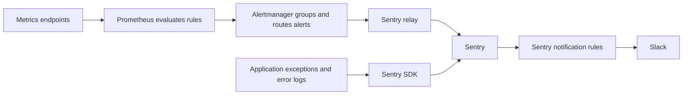

# Sentinel monitoring and alerting

This guide describes Sentinel's monitoring checks, why each matters, and how alerts
reach the team. The overview groups related alerts by their purpose. Active checks,
thresholds and notification destinations depend on the monitoring configuration;
running Sentinel alone does not enable every alert described here.

## Alert overview

### Service symptoms

These checks tell us whether an operation fails or takes too long. They do not
necessarily identify the cause.

| What we monitor | Why it matters | What triggers an alert | Example | How it works |
| --- | --- | --- | --- | --- |
| **Web endpoint and HTTPS — Blackbox Exporter** | Check that the public web endpoint is reachable and its certificate remains valid. This does not test Django or the database. | Failed `/alive/` checks or a certificate approaching expiry. | “Sentinel’s web endpoint is unreachable.” | Blackbox Exporter requests `/alive/`, which nginx answers directly, and checks the certificate → metrics → Prometheus. |
| **Application errors — Sentry SDK** | Capture failed requests, failed background jobs and explicitly logged errors. | Eligible Django/Celery exceptions or ERROR-level logs; Sentry rules control notifications. | “APY calculation crashed.” | Application exception/error log → Sentry SDK → Sentry directly. Requires `SENTRY_DSN`. |
| **Grafana query health** | Observe actual query failures and slowdowns; scheduled PostgreSQL probes also run without dashboard traffic. | Selected HTTP query errors, elevated data-source error rates, slow requests, or failed/slow representative probes. | “Weights chart timed out,” or “APY probe returned no data.” | nginx logs → Alloy metrics; Grafana → built-in metrics; Celery probes → `MonitoringResult` → application metrics. All feed Prometheus. |

Chart-request checks observe requests reaching Sentinel nginx, not browser rendering
or failures before that endpoint. Their HTTP error checks exclude 401 and 499.
Scheduled probes test the connection and representative snapshot/APY queries; they
do not run every panel or test every data source. An empty chart is not automatically
an incident, whereas an empty result from a probe that expects data is a failure.

### Data quality

These checks tell us whether stored data is fresh and complete, independently of
whether the application is reachable.

| What we monitor | Why it matters | What triggers an alert | Example | How it works |
| --- | --- | --- | --- | --- |
| **Data freshness** | Detect ingestion falling behind despite services remaining reachable. | Expected snapshot, APY or extrinsics source data is missing or stays older than its age limit. | “Subnet 1 has no recent snapshots.” | Celery checks source timestamps, using recorded ingestion progress for extrinsics → `MonitoringResult` → application metrics → Prometheus. |
| **Historical snapshot completeness** | Detect missing past snapshots even while new snapshots arrive normally. | Missing expected snapshot blocks in the 7-day window, bounded by the configured collection start, persist for 3 hours. | “Yesterday’s snapshot blocks are still missing.” | Completeness task counts expected blocks with no neuron snapshots → `SnapshotHealthMetric` → application metrics → Prometheus. |

Freshness uses blockchain/epoch source time, not the time a backfill was processed.
Snapshots and APY are checked per monitored subnet; extrinsics progress is checked
for the chain as a whole. Snapshot completeness is relative to the latest stored
block and does not detect partially missing neurons within a snapshot.

### Resources and processes

These checks identify conditions that can explain failures or warn before an
outage. High CPU, for example, is a possible explanation for a slow chart, not
proof of its cause.

| What we monitor | Why it matters | What triggers an alert | Example | How it works |
| --- | --- | --- | --- | --- |
| **Server resources — Node Exporter** | Detect resource shortages that can slow or stop services. | CPU overload, low disk/RAM, OOM kills or low OS entropy. | “Disk has less than 5% free.” | Host statistics → Node Exporter metrics → Prometheus. |
| **Containers — cAdvisor** | Identify repeated restarts and gaps in container observations. | Repeated start-time changes or sparse recent container samples matching the configured rules. | “Celery worker keeps restarting.” | Container observations/start times → cAdvisor metrics → Prometheus. |
| **Background task progress** | Detect jobs that stop completing without necessarily reporting an exception. | Data-health, probe, APY or completeness tasks exceed their completion deadlines. | “APY calculation stopped completing.” | Tasks update `MonitoringProgress` → application metrics → Prometheus. |

Container observation rules are not a reliable inventory of required services:
a container's metric series can disappear without producing a missing-container
alert. Task-progress checks track completed batches; a completed probe batch can
still contain failed queries, which the Grafana query checks report separately.

### Monitoring health

These checks tell us whether we can trust the absence of other alerts.

| What we monitor | Why it matters | What triggers an alert | Example | How it works |
| --- | --- | --- | --- | --- |
| **Metrics and log collection** | Detect blind spots: a quiet monitoring system may itself be broken. | Failed scrapes, missing expected metrics, or a stale nginx-to-Alloy heartbeat. | “The endpoint responds, but query telemetry is missing.” | Prometheus checks scrape status, expected metrics and heartbeat timestamps. |
| **Monitoring configuration** | Check that probe settings are present and data-health checks include subnets. | Missing probe token, invalid probe subnet settings, or an empty monitored subnet inventory. | “Grafana probes have no token.” | Application exposes configuration status and inventory metrics → Prometheus. A present but rejected token is detected by running a probe. |

### How alerts reach the team

Prometheus evaluates metric-based alert rules. Alertmanager groups and routes the
resulting alerts; it does not evaluate the metric thresholds. Application errors
reach Sentry directly through its SDK.

The diagram shows the route for metric alerts configured to use Sentry, alongside
application errors sent directly by the SDK:

Application metrics reach shared monitoring through `/application-metrics/`;
Grafana metrics through `/grafana-metrics/`; Alloy's chart-query metrics through
`/grafana-query-metrics/`.

Sentry notification rules select the Slack channel and notification frequency;
capturing an event does not guarantee a Slack message. With automatic resolution
disabled in the relay, a resolved Prometheus alert does not automatically close
the Sentry issue or send a Slack recovery message. Chart-failure alerts expire
when no recent failure has been observed; that does not prove a successful retry.
